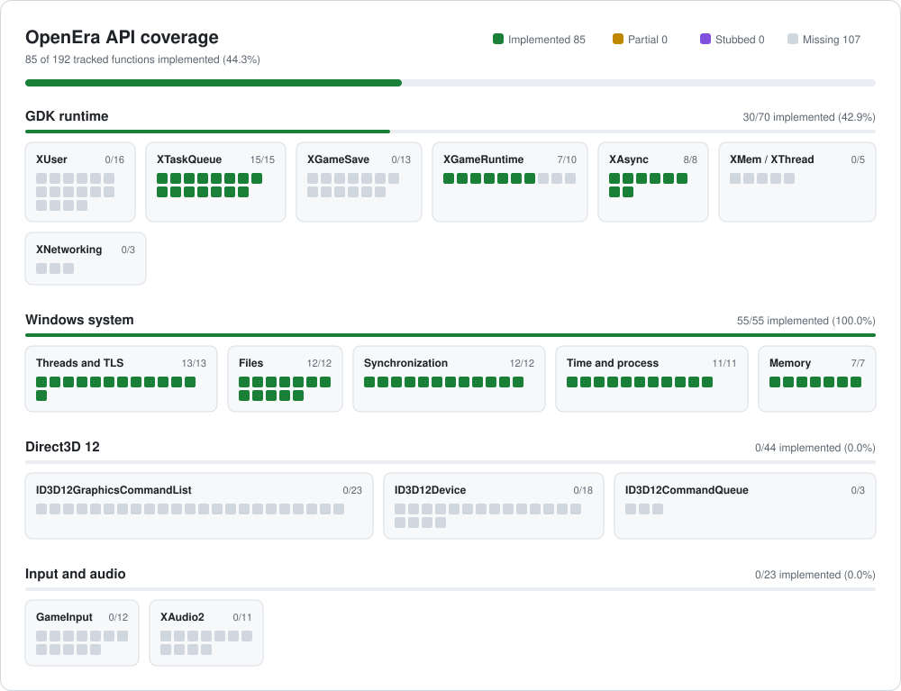
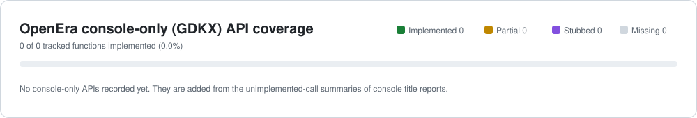

# Compatibility

What OpenEra can do today, subsystem by subsystem, and how much of the public API surface titles depend on is implemented.

OpenEra is in early development: **no titles run yet**. The first target is Xbox Series X|S (GDK) titles, run from an unpacked title folder you own. Xbox One (Era) titles come later.

The loader can already load a title and its own DLLs and link them, binding plain Win32 and C runtime imports to the host's Windows DLLs. Console system modules, graphics, audio and input aren't implemented yet, so those calls land in recorded stubs.

## API coverage

Each square is one function.

The tracked functions are the public APIs needed for milestone [M1: Series X|S title boots to menu](https://github.com/PlutonusDev/OpenEra/milestone/1), taken from public documentation (Microsoft Learn: Microsoft Game Development Kit, GameInput, Direct3D 12, XAudio2 and Win32 references). The list will be refined from the unimplemented-call summaries of real runs.

## Feature status

| Area | Feature | Status | Tracking |
| :--- | :--- | :---: | :--- |
| Loader | PE32+ headers, sections, imports and exports | ✅ Done | #4, #7 |
| Loader | Relocation, TLS, exception and delay-import directories | ✅ Done | #12 |
| Loader | Map images into memory (relocate, protect) | ✅ Done | #11 |
| Loader | Import binding with recorded-stub fallback | ✅ Done | #13 |
| Loader | Pass Win32 and C runtime imports through to host DLLs | ✅ Done | #47 |
| Loader | Load and link a title's own DLLs; runtime `LoadLibrary` / `GetProcAddress` | ✅ Done | #48 |
| Loader | Register x64 unwind data; C++ and structured exceptions in mapped images | ✅ Done | #14 |
| Loader | Static TLS, TLS callbacks, DllMain and the entry point | ✅ Done | #15 |
| App | Run an unpacked title folder from `MicrosoftGame.config` | ✅ Done | #50 |
| App | `openera` command-line launcher (`run` and `info` for title folders) | 🟡 In progress | #32 |
| Kernel | Unimplemented-call registry | ✅ Done | #8 |
| Kernel | Shim module framework and exception guards | ✅ Done | #21 |
| Kernel | Map console system modules onto shims and host DLLs | ⚪ Planned | #53 |
| Kernel | Path redirection | 🟡 In progress | #22 |
| Kernel | Copy-on-write file layer over the title folder | ✅ Done | #54 |
| Kernel | DirectStorage | ⚪ Planned | #56 |
| Kernel | Memory management | 🟡 In progress | #23 |
| Kernel | Threading, synchronization and timing | ✅ Done | #24 |
| Kernel | XGameRuntime, XTaskQueue and XAsync | ✅ Done | #25 |
| Kernel | XUser and system services | ⚪ Planned | #26 |
| Graphics | Desktop DXGI / Direct3D 12 on the preferred GPU (NVIDIA or AMD first, `--gpu` to choose) | ✅ Done | #27 |
| Graphics | D3D12.x device and COM wrappers | ⚪ Planned | #27 |
| Graphics | Command list and resource translation | ⚪ Planned | #28 |
| Graphics | RDNA2 shader recompiler (to DXIL) | ⚪ Planned | #55 |
| Graphics | Console texture layouts | ⚪ Planned | #51 |
| Graphics | Presentation to a desktop window | ⚪ Planned | #29 |
| Input | GameInput gamepad mapping | ⚪ Planned | #30 |
| Audio | XMA2 decoding and output | ⚪ Planned | #31 |
| Packages | XVD / XVC header and region table | ✅ Done | #5 |
| Packages | Read unencrypted XVD volumes (after M1) | ⚪ Planned | #16, #17, #18 |
| Packages | Encrypted packages | ❌ Out of scope | Clean-room policy: no keys, no decryption |
| Platform | Xbox One (Era) titles | ⚪ Later | After Series X\|S titles work |

## Titles

No titles have been tested yet. When OpenEra can run something, results will be collected through the [compatibility report](https://github.com/PlutonusDev/OpenEra/issues/new?template=compatibility_report.yml) issue form. Only report titles you own, and never attach game files.

## API matrix

<!-- api-matrix:begin (generated by tools/Update-Compatibility.ps1) -->
| Category | Module | Implemented | Partial | Stubbed | Missing | Coverage |
| :--- | :--- | ---: | ---: | ---: | ---: | ---: |
| GDK runtime | XGameRuntime | 7 | 0 | 0 | 4 | 63.6% |
| GDK runtime | XTaskQueue | 15 | 0 | 0 | 0 | 100.0% |
| GDK runtime | XAsync | 8 | 0 | 0 | 0 | 100.0% |
| GDK runtime | XUser | 0 | 0 | 0 | 16 | 0.0% |
| GDK runtime | XGameSave | 0 | 0 | 0 | 13 | 0.0% |
| GDK runtime | XNetworking | 0 | 0 | 0 | 3 | 0.0% |
| GDK runtime | XMem / XThread | 0 | 0 | 0 | 5 | 0.0% |
| Windows system | Files | 15 | 0 | 0 | 0 | 100.0% |
| Windows system | Memory | 12 | 0 | 0 | 0 | 100.0% |
| Windows system | Threads and TLS | 17 | 0 | 0 | 0 | 100.0% |
| Windows system | Synchronization | 14 | 0 | 0 | 0 | 100.0% |
| Windows system | Time and process | 14 | 1 | 0 | 0 | 93.3% |
| Windows system | Other system libraries | 2 | 1 | 0 | 8 | 18.2% |
| Direct3D 12 | ID3D12Device | 0 | 17 | 0 | 1 | 0.0% |
| Direct3D 12 | ID3D12GraphicsCommandList | 0 | 20 | 0 | 3 | 0.0% |
| Direct3D 12 | ID3D12CommandQueue | 0 | 3 | 0 | 0 | 0.0% |
| Input and audio | GameInput | 0 | 0 | 0 | 12 | 0.0% |
| Input and audio | XAudio2 | 0 | 0 | 0 | 11 | 0.0% |
| **Total** | | **104** | **42** | **0** | **76** | **46.8%** |

### GDK runtime

<b>XGameRuntime</b>: 7/11 implemented

| Function | Status |
| :--- | :--- |
| `XGameRuntimeInitialize` | ✅ Implemented |
| `XGameRuntimeUninitialize` | ✅ Implemented |
| `XGameRuntimeIsFeatureAvailable` | ✅ Implemented |
| `XGameGetXboxTitleId` | ✅ Implemented |
| `XSystemGetDeviceType` | ✅ Implemented |
| `XSystemGetConsoleId` | ✅ Implemented |
| `XSystemGetAppSpecificDeviceId` | ⬜ Missing |
| `XSystemGetXboxLiveSandboxId` | ✅ Implemented |
| `XPackageGetCurrentProcessPackageIdentifier` | ⬜ Missing |
| `XLaunchUri` | ⬜ Missing |
| `XPackageEnumeratePackages` | ⬜ Missing |

<b>XTaskQueue</b>: 15/15 implemented

| Function | Status |
| :--- | :--- |
| `XTaskQueueCreate` | ✅ Implemented |
| `XTaskQueueCreateComposite` | ✅ Implemented |
| `XTaskQueueGetPort` | ✅ Implemented |
| `XTaskQueueDuplicateHandle` | ✅ Implemented |
| `XTaskQueueDispatch` | ✅ Implemented |
| `XTaskQueueCloseHandle` | ✅ Implemented |
| `XTaskQueueTerminate` | ✅ Implemented |
| `XTaskQueueSubmitCallback` | ✅ Implemented |
| `XTaskQueueSubmitDelayedCallback` | ✅ Implemented |
| `XTaskQueueRegisterWaiter` | ✅ Implemented |
| `XTaskQueueUnregisterWaiter` | ✅ Implemented |
| `XTaskQueueRegisterMonitor` | ✅ Implemented |
| `XTaskQueueUnregisterMonitor` | ✅ Implemented |
| `XTaskQueueGetCurrentProcessTaskQueue` | ✅ Implemented |
| `XTaskQueueSetCurrentProcessTaskQueue` | ✅ Implemented |

<b>XAsync</b>: 8/8 implemented

| Function | Status |
| :--- | :--- |
| `XAsyncBegin` | ✅ Implemented |
| `XAsyncComplete` | ✅ Implemented |
| `XAsyncGetStatus` | ✅ Implemented |
| `XAsyncGetResultSize` | ✅ Implemented |
| `XAsyncGetResult` | ✅ Implemented |
| `XAsyncCancel` | ✅ Implemented |
| `XAsyncRun` | ✅ Implemented |
| `XAsyncSchedule` | ✅ Implemented |

<b>XUser</b>: 0/16 implemented

| Function | Status |
| :--- | :--- |
| `XUserAddAsync` | ⬜ Missing |
| `XUserAddResult` | ⬜ Missing |
| `XUserDuplicateHandle` | ⬜ Missing |
| `XUserCloseHandle` | ⬜ Missing |
| `XUserGetId` | ⬜ Missing |
| `XUserGetLocalId` | ⬜ Missing |
| `XUserGetGamertag` | ⬜ Missing |
| `XUserGetState` | ⬜ Missing |
| `XUserGetIsGuest` | ⬜ Missing |
| `XUserGetAgeGroup` | ⬜ Missing |
| `XUserCheckPrivilege` | ⬜ Missing |
| `XUserRegisterForChangeEvent` | ⬜ Missing |
| `XUserUnregisterForChangeEvent` | ⬜ Missing |
| `XUserGetGamerPictureAsync` | ⬜ Missing |
| `XUserGetGamerPictureResultSize` | ⬜ Missing |
| `XUserGetGamerPictureResult` | ⬜ Missing |

<b>XGameSave</b>: 0/13 implemented

| Function | Status |
| :--- | :--- |
| `XGameSaveInitializeProvider` | ⬜ Missing |
| `XGameSaveInitializeProviderAsync` | ⬜ Missing |
| `XGameSaveInitializeProviderResult` | ⬜ Missing |
| `XGameSaveCloseProvider` | ⬜ Missing |
| `XGameSaveGetRemainingQuota` | ⬜ Missing |
| `XGameSaveCreateContainer` | ⬜ Missing |
| `XGameSaveCloseContainer` | ⬜ Missing |
| `XGameSaveEnumerateContainerInfo` | ⬜ Missing |
| `XGameSaveCreateUpdate` | ⬜ Missing |
| `XGameSaveSubmitBlobWrite` | ⬜ Missing |
| `XGameSaveSubmitUpdate` | ⬜ Missing |
| `XGameSaveCloseUpdate` | ⬜ Missing |
| `XGameSaveReadBlobData` | ⬜ Missing |

<b>XNetworking</b>: 0/3 implemented

| Function | Status |
| :--- | :--- |
| `XNetworkingGetConnectivityHint` | ⬜ Missing |
| `XNetworkingRegisterConnectivityHintChanged` | ⬜ Missing |
| `XNetworkingUnregisterConnectivityHintChanged` | ⬜ Missing |

<b>XMem / XThread</b>: 0/5 implemented

| Function | Status |
| :--- | :--- |
| `XMemAllocDefault` | ⬜ Missing |
| `XMemFreeDefault` | ⬜ Missing |
| `XMemSetAllocationHooks` | ⬜ Missing |
| `XThreadIsTimeSensitive` | ⬜ Missing |
| `XThreadSetTimeSensitive` | ⬜ Missing |

### Windows system

<b>Files</b>: 15/15 implemented

| Function | Status |
| :--- | :--- |
| `CreateFileW` | ✅ Implemented |
| `ReadFile` | ✅ Implemented |
| `WriteFile` | ✅ Implemented |
| `CloseHandle` | ✅ Implemented |
| `GetFileSizeEx` | ✅ Implemented |
| `SetFilePointerEx` | ✅ Implemented |
| `GetFileAttributesW` | ✅ Implemented |
| `FindFirstFileW` | ✅ Implemented |
| `FindNextFileW` | ✅ Implemented |
| `FindClose` | ✅ Implemented |
| `CreateDirectoryW` | ✅ Implemented |
| `DeleteFileW` | ✅ Implemented |
| `CreateFile2` | ✅ Implemented |
| `CreateFileMappingFromApp` | ✅ Implemented |
| `FlushViewOfFile` | ✅ Implemented |

<b>Memory</b>: 12/12 implemented

| Function | Status |
| :--- | :--- |
| `VirtualAlloc` | ✅ Implemented |
| `VirtualFree` | ✅ Implemented |
| `VirtualProtect` | ✅ Implemented |
| `VirtualQuery` | ✅ Implemented |
| `HeapAlloc` | ✅ Implemented |
| `HeapFree` | ✅ Implemented |
| `GetProcessHeap` | ✅ Implemented |
| `VirtualAlloc2` | ✅ Implemented |
| `MapViewOfFile3` | ✅ Implemented |
| `GlobalMemoryStatusEx` | ✅ Implemented |
| `K32GetProcessMemoryInfo` | ✅ Implemented |
| `GetLargePageMinimum` | ✅ Implemented |

<b>Threads and TLS</b>: 17/17 implemented

| Function | Status |
| :--- | :--- |
| `CreateThread` | ✅ Implemented |
| `ExitThread` | ✅ Implemented |
| `GetCurrentThreadId` | ✅ Implemented |
| `SetThreadPriority` | ✅ Implemented |
| `SetThreadAffinityMask` | ✅ Implemented |
| `SetThreadDescription` | ✅ Implemented |
| `Sleep` | ✅ Implemented |
| `SleepEx` | ✅ Implemented |
| `SwitchToThread` | ✅ Implemented |
| `TlsAlloc` | ✅ Implemented |
| `TlsGetValue` | ✅ Implemented |
| `TlsSetValue` | ✅ Implemented |
| `TlsFree` | ✅ Implemented |
| `GetThreadDescription` | ✅ Implemented |
| `SetThreadIdealProcessorEx` | ✅ Implemented |
| `GetCurrentThreadStackLimits` | ✅ Implemented |
| `QueryThreadCycleTime` | ✅ Implemented |

<b>Synchronization</b>: 14/14 implemented

| Function | Status |
| :--- | :--- |
| `InitializeCriticalSection` | ✅ Implemented |
| `EnterCriticalSection` | ✅ Implemented |
| `LeaveCriticalSection` | ✅ Implemented |
| `DeleteCriticalSection` | ✅ Implemented |
| `InitializeSRWLock` | ✅ Implemented |
| `AcquireSRWLockExclusive` | ✅ Implemented |
| `ReleaseSRWLockExclusive` | ✅ Implemented |
| `CreateEventW` | ✅ Implemented |
| `SetEvent` | ✅ Implemented |
| `ResetEvent` | ✅ Implemented |
| `WaitForSingleObject` | ✅ Implemented |
| `WaitForMultipleObjects` | ✅ Implemented |
| `WaitOnAddress` | ✅ Implemented |
| `CreateWaitableTimerExW` | ✅ Implemented |

<b>Time and process</b>: 14/15 implemented

| Function | Status |
| :--- | :--- |
| `QueryPerformanceCounter` | ✅ Implemented |
| `QueryPerformanceFrequency` | ✅ Implemented |
| `GetSystemTimeAsFileTime` | ✅ Implemented |
| `GetTickCount64` | ✅ Implemented |
| `GetSystemInfo` | ✅ Implemented |
| `GetLastError` | ✅ Implemented |
| `SetLastError` | ✅ Implemented |
| `OutputDebugStringW` | ✅ Implemented |
| `GetModuleHandleW` | ✅ Implemented |
| `GetProcAddress` | ✅ Implemented |
| `LoadLibraryExW` | ✅ Implemented |
| `GetSystemTimePreciseAsFileTime` | ✅ Implemented |
| `QueryUnbiasedInterruptTime` | ✅ Implemented |
| `GetLogicalProcessorInformationEx` | ✅ Implemented |
| `RtlCaptureStackBackTrace` | 🟡 Partial |

<b>Other system libraries</b>: 2/11 implemented

| Function | Status |
| :--- | :--- |
| `WSAStartup` | ✅ Implemented |
| `WSAPoll` | ✅ Implemented |
| `CoInitializeEx` | 🟡 Partial |
| `RoInitialize` | ⬜ Missing |
| `GetAdaptersAddresses` | ⬜ Missing |
| `WinHttpOpen` | ⬜ Missing |
| `NtQuerySystemInformation` | ⬜ Missing |
| `NtQueryInformationProcess` | ⬜ Missing |
| `NtAllocateVirtualMemory` | ⬜ Missing |
| `NtDelayExecution` | ⬜ Missing |
| `RtlGetVersion` | ⬜ Missing |

### Direct3D 12

<b>ID3D12Device</b>: 0/18 implemented

| Function | Status |
| :--- | :--- |
| `CreateCommandQueue` | 🟡 Partial |
| `CreateCommandAllocator` | 🟡 Partial |
| `CreateCommandList` | 🟡 Partial |
| `CreateGraphicsPipelineState` | 🟡 Partial |
| `CreateComputePipelineState` | 🟡 Partial |
| `CreateRootSignature` | 🟡 Partial |
| `CreateDescriptorHeap` | 🟡 Partial |
| `GetDescriptorHandleIncrementSize` | 🟡 Partial |
| `CreateConstantBufferView` | 🟡 Partial |
| `CreateShaderResourceView` | 🟡 Partial |
| `CreateUnorderedAccessView` | 🟡 Partial |
| `CreateRenderTargetView` | 🟡 Partial |
| `CreateDepthStencilView` | 🟡 Partial |
| `CreateSampler` | ⬜ Missing |
| `CreateCommittedResource` | 🟡 Partial |
| `CreateHeap` | 🟡 Partial |
| `CreatePlacedResource` | 🟡 Partial |
| `CreateFence` | 🟡 Partial |

<b>ID3D12GraphicsCommandList</b>: 0/23 implemented

| Function | Status |
| :--- | :--- |
| `Close` | 🟡 Partial |
| `Reset` | 🟡 Partial |
| `DrawInstanced` | 🟡 Partial |
| `DrawIndexedInstanced` | ⬜ Missing |
| `Dispatch` | 🟡 Partial |
| `ExecuteIndirect` | 🟡 Partial |
| `CopyBufferRegion` | 🟡 Partial |
| `CopyTextureRegion` | 🟡 Partial |
| `ResourceBarrier` | 🟡 Partial |
| `SetPipelineState` | 🟡 Partial |
| `SetGraphicsRootSignature` | 🟡 Partial |
| `SetComputeRootSignature` | 🟡 Partial |
| `SetDescriptorHeaps` | 🟡 Partial |
| `SetGraphicsRootDescriptorTable` | 🟡 Partial |
| `SetGraphicsRoot32BitConstants` | 🟡 Partial |
| `IASetPrimitiveTopology` | 🟡 Partial |
| `IASetVertexBuffers` | 🟡 Partial |
| `IASetIndexBuffer` | ⬜ Missing |
| `RSSetViewports` | 🟡 Partial |
| `RSSetScissorRects` | 🟡 Partial |
| `OMSetRenderTargets` | 🟡 Partial |
| `ClearRenderTargetView` | 🟡 Partial |
| `ClearDepthStencilView` | ⬜ Missing |

<b>ID3D12CommandQueue</b>: 0/3 implemented

| Function | Status |
| :--- | :--- |
| `ExecuteCommandLists` | 🟡 Partial |
| `Signal` | 🟡 Partial |
| `Wait` | 🟡 Partial |

### Input and audio

<b>GameInput</b>: 0/12 implemented

| Function | Status |
| :--- | :--- |
| `GameInputCreate` | ⬜ Missing |
| `IGameInput::GetCurrentReading` | ⬜ Missing |
| `IGameInput::GetNextReading` | ⬜ Missing |
| `IGameInput::GetPreviousReading` | ⬜ Missing |
| `IGameInput::RegisterDeviceCallback` | ⬜ Missing |
| `IGameInput::UnregisterCallback` | ⬜ Missing |
| `IGameInput::FindDeviceFromId` | ⬜ Missing |
| `IGameInputReading::GetGamepadState` | ⬜ Missing |
| `IGameInputReading::GetTimestamp` | ⬜ Missing |
| `IGameInputReading::GetDevice` | ⬜ Missing |
| `IGameInputDevice::GetDeviceInfo` | ⬜ Missing |
| `IGameInputDevice::SetRumbleState` | ⬜ Missing |

<b>XAudio2</b>: 0/11 implemented

| Function | Status |
| :--- | :--- |
| `XAudio2Create` | ⬜ Missing |
| `IXAudio2::CreateMasteringVoice` | ⬜ Missing |
| `IXAudio2::CreateSourceVoice` | ⬜ Missing |
| `IXAudio2::CreateSubmixVoice` | ⬜ Missing |
| `IXAudio2::StartEngine` | ⬜ Missing |
| `IXAudio2::StopEngine` | ⬜ Missing |
| `IXAudio2SourceVoice::SubmitSourceBuffer` | ⬜ Missing |
| `IXAudio2SourceVoice::Start` | ⬜ Missing |
| `IXAudio2SourceVoice::Stop` | ⬜ Missing |
| `IXAudio2SourceVoice::FlushSourceBuffers` | ⬜ Missing |
| `IXAudio2Voice::SetVolume` | ⬜ Missing |

<!-- api-matrix:end -->

## Console-only (GDKX) APIs

Console titles also call APIs that exist only on the console (the GDKX side of the GDK), with no public reference. They are tracked here separately, and they still need implementing.

- **Where the list comes from:** only the unimplemented-call summaries in compatibility reports, which record what a title was seen to import. Nothing is copied from private SDK headers, libraries or documentation.
- **Implementing one:** follow the same clean-room rules as the rest of OpenEra. Work from observed behaviour (arguments, return values and side effects seen at run time) or a public source. Record what can't be determined as a stub rather than guessing.
- **Statuses:** functions start as missing and move to stubbed, partial or implemented as shims land. The **Seen in** column links the reports that hit each one, which shows what to work on first.

<!-- gdkx-matrix:begin (generated by tools/Update-GdkxCoverage.ps1) -->
| Category | Module | Implemented | Partial | Stubbed | Missing | Coverage |
| :--- | :--- | ---: | ---: | ---: | ---: | ---: |
| Direct3D 12.x | d3d12_xs | 0 | 0 | 0 | 1 | 0.0% |
| Memory | xmem | 0 | 0 | 0 | 7 | 0.0% |
| Audio | AcpHal | 0 | 0 | 0 | 6 | 0.0% |
| Storage | XCRDAPI | 0 | 0 | 0 | 1 | 0.0% |
| System | XFrontPanelDisplay | 0 | 0 | 0 | 1 | 0.0% |
| **Total** | | **0** | **0** | **0** | **16** | **0.0%** |

### Direct3D 12.x

<b>d3d12_xs</b>: 0/1 implemented

| Function | Status | Seen in |
| :--- | :--- | :--- |
| `D3D12XboxCreateDevice` | ⬜ Missing | #104 |

### Memory

<b>xmem</b>: 0/7 implemented

| Function | Status | Seen in |
| :--- | :--- | :--- |
| `XMemAlloc` | ⬜ Missing | #104 |
| `XMemMakeTag` | ⬜ Missing | #104 |
| `XMemVirtualAlloc` | ⬜ Missing | #104 |
| `XMemGetPhysicalMemoryLayout` | ⬜ Missing | #104 |
| `XMemAllocatePhysicalPages` | ⬜ Missing | #104 |
| `XMemGetWorkingSetStatistics` | ⬜ Missing | #104 |
| `XMemCreateWin32Heap` | ⬜ Missing | #104 |

### Audio

<b>AcpHal</b>: 0/6 implemented

| Function | Status | Seen in |
| :--- | :--- | :--- |
| `ApuCreateHeap` | ⬜ Missing | #104 |
| `ApuHeapGetState` | ⬜ Missing | #104 |
| `ApuAlloc` | ⬜ Missing | #104 |
| `ApuMapVirtualAddress` | ⬜ Missing | #104 |
| `ApuMapApuAddress` | ⬜ Missing | #104 |
| `ApuIsVirtualAddressValid` | ⬜ Missing | #104 |

### Storage

<b>XCRDAPI</b>: 0/1 implemented

| Function | Status | Seen in |
| :--- | :--- | :--- |
| `DStorageGetFactory` | ⬜ Missing | #104 |

### System

<b>XFrontPanelDisplay</b>: 0/1 implemented

| Function | Status | Seen in |
| :--- | :--- | :--- |
| `XFrontPanelIsSupported` | ⬜ Missing | #104 |

<!-- gdkx-matrix:end -->

## Updating this page

1. Change a function's status in [`docs/compatibility/api-status.json`](docs/compatibility/api-status.json), or add a module or function there (public APIs only).
2. Run `tools/Update-Compatibility.ps1` to regenerate the coverage image and the API matrix above.
3. Commit all three files. CI runs the script with `-Check` and fails if they are out of date.

For console-only APIs, save the unimplemented-call summary from a report to a file and run `tools/Import-GdkxReport.ps1 -Log <file> -Source '#<issue>'`. It adds new functions to [`docs/compatibility/gdkx-status.json`](docs/compatibility/gdkx-status.json) and regenerates the section above. To change a status there by hand, edit the file and run `tools/Update-GdkxCoverage.ps1`.
