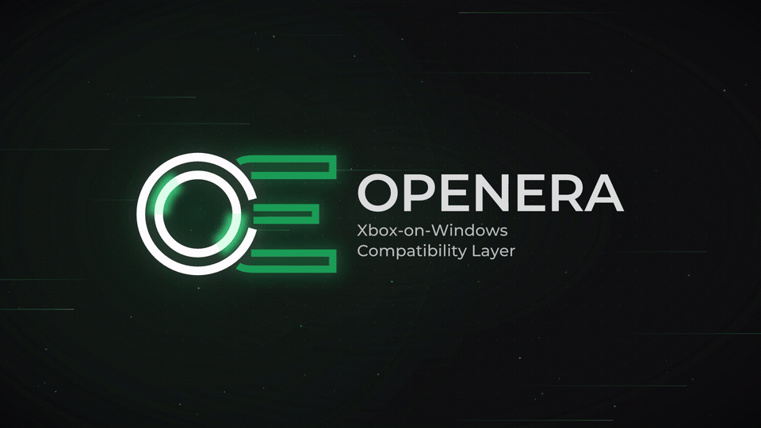

<div align="center">



**An open-source compatibility layer for running Xbox Series X|S titles natively on Windows.**

[](https://discord.gg/openera)
[](LICENSE)


[**Join our Discord**](https://discord.gg/openera) · [API Coverage](#api-coverage) · [Architecture](#architecture) · [Project Status](#project-status) · [Compatibility](COMPATIBILITY.md) · [Building](#building-from-source)

</div>

---

OpenEra is an experimental translation layer and runtime environment for Xbox titles. Its first target is **GameCore**: Xbox Series X|S titles built with the GDK. **Era** (Xbox One) titles are a later goal.

Modern Xbox consoles run a customized Windows NT kernel and Direct3D 12 runtime under a hypervisor, on the same x86-64 architecture as a desktop PC. So OpenEra doesn't emulate the CPU. The title's code runs natively. OpenEra loads it with its own PE loader, reimplements the console system modules it calls, recompiles its GPU shaders for desktop Direct3D 12, and passes plain Win32 and C runtime calls through to Windows.

OpenEra runs an **unpacked title folder** you own (the folder containing `MicrosoftGame.config`). It never decrypts or unpacks game packages.

> [!IMPORTANT]
> OpenEra is an educational and interoperability research project developed under a strict clean-room policy. It contains no Microsoft binaries, encryption keys, SDK headers or game assets. You supply your own unpacked titles.

## 💬 Community

Development discussion, progress updates and help all happen on Discord.

<div align="center">

### [👉 Join the OpenEra Discord 👈](https://discord.gg/openera)

</div>

## API Coverage

<a href="COMPATIBILITY.md"></a>

Each square is a public API function a title can call. See [COMPATIBILITY.md](COMPATIBILITY.md) for the full API matrix and feature status.

## Architecture

OpenEra bridges the differences between the GameCore environment and standard Windows APIs:

| Subsystem | Responsibility |
| :--- | :--- |
| **Loader** | Loads the title's executable and its own DLLs with OpenEra's PE loader, and binds imports to title modules, OpenEra shims or the host's Windows DLLs. Anything unimplemented becomes a recorded stub. |
| **Kernel & System Modules** | Reimplements the console system modules titles import, mapping compatible functions onto desktop Windows and shimming the rest: memory, threading, files and the Gaming Runtime. |
| **Graphics (D3D12.x → D3D12)** | Maps Xbox Direct3D 12 extensions onto desktop Direct3D 12, recompiles RDNA2 shader code to DXIL and detiles console texture layouts. |
| **Storage** | Redirects title paths to the title folder through a copy-on-write layer, so the original files are never modified, and handles DirectStorage requests. |
| **Audio** | Redirects XMA2 hardware audio decoding to a host decoder. |
| **Input & System Services** | Maps Xbox Gaming Runtime Services and controller protocols to Windows `Gaming.Input` / XInput. |

## Project Status

OpenEra is in **early development**. No commercial titles run yet.

| Component | Area | Status | Notes |
| :--- | :--- | :---: | :--- |
| Build system & CI tooling | `CMake` | ✅ Done | C++20, `/W4 /WX`, MSVC + Clang-CL, C++ Core Check, clang-format / clang-tidy, Catch2 tests. |
| Binary stream reader | `Core` | ✅ Done | Bounds-checked, non-throwing `ByteReader` used by every parser. |
| Logging | `Core` | ✅ Done | Thread-safe, levelled logger with pluggable sinks. |
| PE/COFF reader | `Loader` | ✅ Done | PE32+ headers, sections, imports, exports, relocations, TLS, exception and delay-import directories. |
| PE/DLL loader & import resolver | `Loader` | 🟡 In progress | Loads the title and its own DLLs, links them to each other, to shims and to host Windows DLLs, registers their unwind data so exceptions work, and starts them (static TLS, TLS callbacks, DllMain and the entry point). |
| Run an unpacked title folder | `App` | ✅ Done | `openera run` reads `MicrosoftGame.config` and starts the title. |
| Console system modules | `Kernel` | 🟡 In progress | Shim framework and unimplemented-call registry in place; module mapping and API shims next. |
| Direct3D 12.x translation | `Graphics` | ⚪ Planned | COM wrappers, command list translation and presentation. |
| Shader recompiler | `Graphics` | ⚪ Planned | RDNA2 shader code to DXIL. |
| Storage | `Kernel` | ⚪ Planned | Path redirection, copy-on-write file layer and DirectStorage. |
| Controller input | `Input` | ⚪ Planned | GameInput gamepad mapping. |
| Audio subsystem | `Audio` | ⚪ Planned | XMA2 decoding and audio endpoint mapping. |
| XVD / XVC container parser | `Loader` | ✅ Done | Header validation, section layout and XVC region table. Unencrypted only; not needed for M1. |
| First Series X\|S title booting to menu | Milestone | ⚪ Planned | [M1](https://github.com/PlutonusDev/OpenEra/milestone/1): the first end-to-end compatibility milestone. |
| Xbox One (Era) titles | Later | ⚪ Planned | After Series X\|S titles work. |

**Legend:** ✅ Done · 🟡 In progress / in review · ⚪ Planned

## Building from Source

### Prerequisites

| Requirement | Version |
| :--- | :--- |
| **OS** | Windows 10 (22H2+) or Windows 11, x64 |
| **Compiler** | Visual Studio 2022+ (MSVC v143+) or Clang-CL |
| **Build tools** | CMake 3.25+ and Ninja |
| **SDK** | Windows 11 SDK (10.0.22621.0 or newer) |

### Build and test

Run these from a **Visual Studio Developer PowerShell (x64)**:

```powershell
git clone https://github.com/PlutonusDev/OpenEra.git
cd OpenEra

cmake -B build -G Ninja -DCMAKE_BUILD_TYPE=Release
cmake --build build
ctest --test-dir build --output-on-failure
```

To build with Clang-CL instead, add `-DCMAKE_CXX_COMPILER=clang-cl` to the first `cmake` command.

### Running a title

`openera` runs an unpacked title folder, the folder that contains `MicrosoftGame.config`:

```powershell
build\src\App\openera.exe info <title folder>
build\src\App\openera.exe run <title folder>
```

`run` starts the Xbox Series X|S executable by default; `--exe <Id>` picks another one from the config, and `--no-start` only loads and links it. Logging is set with `--log-level` (`trace`, `info`, `warn` or `error`) and `--log-file <path>`. Run `openera --help` for the full list.

After the title runs, `openera` exits with the title's own exit code. Otherwise it exits with:

| Code | Meaning |
| :---: | :--- |
| 0 | Success |
| 1 | Unexpected error |
| 2 | Bad command line |
| 3 | Not a folder, or a game package (OpenEra never decrypts or unpacks packages) |
| 4 | `MicrosoftGame.config` missing or unusable, or no such executable |
| 5 | Loading or linking the title failed |
| 6 | Starting the title failed |

## Contributing

Contributions are welcome. Before starting on something large, say hello on [Discord](https://discord.gg/openera) so work isn't duplicated.

All contributions must follow the clean-room policy. Only use public documentation, observable runtime behaviour, or compatibly licensed open-source projects (with attribution). Never submit leaked code, disassembled Microsoft code, SDK headers or keys.

## License

OpenEra is licensed under the [GNU General Public License v3.0](LICENSE).

<sub>Xbox, Xbox One, Xbox Series X|S and Direct3D are trademarks of Microsoft Corporation. OpenEra is not affiliated with or endorsed by Microsoft.</sub>
