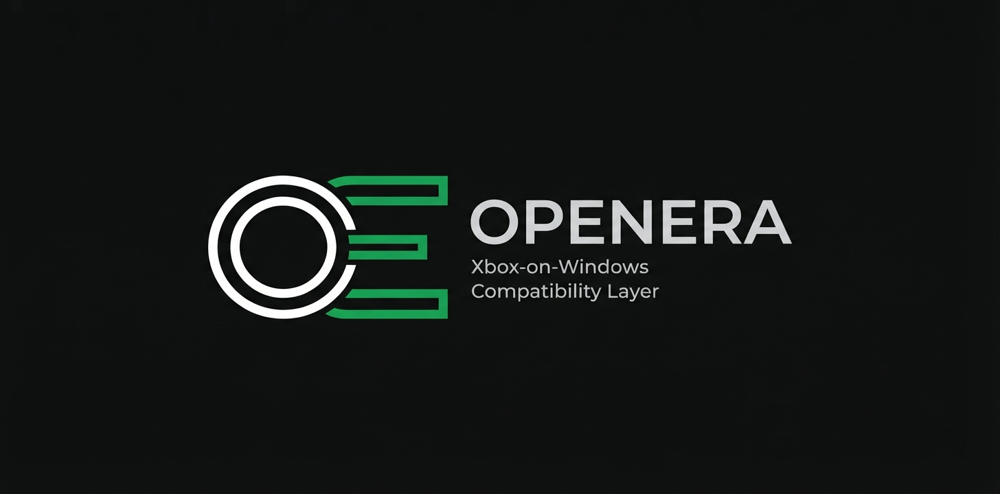
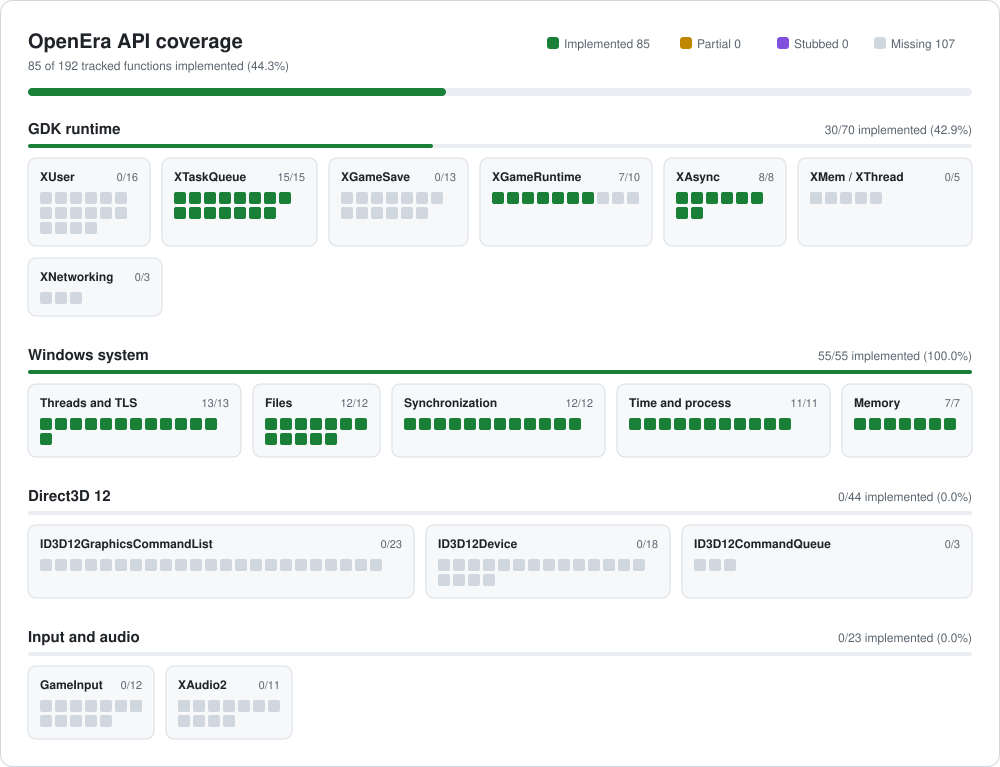

<div align="center">



**An open-source compatibility layer for running Xbox One and Xbox Series X|S titles natively on Windows.**

[](https://discord.gg/Bdaubmzk8x)
[](LICENSE)


[**Join our Discord**](https://discord.gg/Bdaubmzk8x) · [Architecture](#architecture) · [Project Status](#project-status) · [Compatibility](COMPATIBILITY.md) · [Building](#building-from-source)

</div>

---

OpenEra is an experimental translation layer and runtime environment for Xbox titles built for **Era** (Xbox One) and **GameCore** (Xbox Series X|S).

Modern Xbox consoles run a customized Windows NT kernel and Direct3D 12 runtime under a hypervisor, on the same x86-64 architecture as a desktop PC. So OpenEra doesn't emulate the CPU. It translates APIs, shims syscalls and abstracts the hardware.

> [!IMPORTANT]
> OpenEra is an educational and interoperability research project developed under a strict clean-room policy. It contains no Microsoft binaries, encryption keys, SDK headers or game assets. You must supply your own legally obtained dumps.

## 💬 Community

Development discussion, progress updates and help all happen on Discord.

<div align="center">

### [👉 Join the OpenEra Discord 👈](https://discord.gg/Bdaubmzk8x)

</div>

## Architecture

OpenEra bridges the differences between the Era / GameCore environments and standard Windows APIs:

| Subsystem | Responsibility |
| :--- | :--- |
| **Kernel & Syscall Shim** | Translates Xbox-specific NT kernel calls, memory allocation flags and threading primitives to their desktop NT equivalents. |
| **Graphics (D3D12.x → D3D12)** | Maps Xbox Direct3D 12 extensions, custom command list formats and ESRAM / memory aliasing onto desktop Direct3D 12. |
| **Loader & Storage** | Parses PE images and XVD / XVC containers, resolves imports and redirects package mounts to the host filesystem. |
| **Audio** | Redirects XMA2 hardware audio decoding to a host decoder. |
| **Input & System Services** | Maps Xbox Gaming Runtime Services and controller protocols to Windows `Gaming.Input` / XInput. |

## Project Status

OpenEra is in **early development**. No commercial titles run yet.

| Component | Area | Status | Notes |
| :--- | :--- | :---: | :--- |
| Build system & CI tooling | `CMake` | ✅ Done | C++20, `/W4 /WX`, MSVC + Clang-CL, C++ Core Check, clang-format / clang-tidy, Catch2 tests. |
| Binary stream reader | `Core` | ✅ Done | Bounds-checked, non-throwing `ByteReader` used by every parser. |
| Logging | `Core` | ✅ Done | Thread-safe, levelled logger with pluggable sinks. |
| PE/COFF reader | `Loader` | ✅ Done | PE32+ headers, sections, imports, exports, relocations, TLS, exception and delay-import directories. |
| XVD / XVC container parser | `Loader` | ✅ Done | Header validation, section layout and XVC region table. Unencrypted only. |
| PE/DLL loader & import resolver | `Loader` | 🟡 In progress | Images map, relocate and link against shims; unresolved imports become recorded stubs. Unwind data and entry point next. |
| Unencrypted package loader | `Loader` | ⚪ Planned | Mounting XVD / XVC drive data as a host filesystem. |
| Era / GameCore kernel thunks | `Kernel` | 🟡 In progress | Shim framework and unimplemented-call registry in place; API shims next. |
| Direct3D 12.x translation | `Graphics` | ⚪ Planned | `d3d12_x` COM wrappers and command buffer translation. |
| Audio subsystem | `Audio` | ⚪ Planned | XMA2 decoding and audio endpoint mapping. |
| Controller input | `Input` | ⚪ Planned | Gamepad mapping to `Gaming.Input` / XInput. |
| First title booting to menu | Milestone | ⚪ Planned | The first end-to-end compatibility milestone. |

**Legend:** ✅ Done · 🟡 In progress / in review · ⚪ Planned

### API coverage

<a href="COMPATIBILITY.md"></a>

Each square is a public API function a title can call. See [COMPATIBILITY.md](COMPATIBILITY.md) for the full API matrix and feature status.

## Building from Source

### Prerequisites

| Requirement | Version |
| :--- | :--- |
| **OS** | Windows 10 (22H2+) or Windows 11, x64 |
| **Compiler** | Visual Studio 2022+ (MSVC v143+) or Clang-CL |
| **Build tools** | CMake 3.25+ and Ninja |
| **SDK** | Windows 11 SDK (10.0.22621.0 or newer) |

### Build and test

Run these from a **Visual Studio Developer PowerShell (x64)**:

```powershell
git clone https://github.com/PlutonusDev/OpenEra.git
cd OpenEra

cmake -B build -G Ninja -DCMAKE_BUILD_TYPE=Release
cmake --build build
ctest --test-dir build --output-on-failure
```

To build with Clang-CL instead, add `-DCMAKE_CXX_COMPILER=clang-cl` to the first `cmake` command.

## Contributing

Contributions are welcome. Before starting on something large, say hello on [Discord](https://discord.gg/Bdaubmzk8x) so work isn't duplicated.

All contributions must follow the clean-room policy. Only use public documentation, observable runtime behaviour, or compatibly licensed open-source projects (with attribution). Never submit leaked code, disassembled Microsoft code, SDK headers or keys.

## License

OpenEra is licensed under the [GNU General Public License v3.0](LICENSE).

<sub>Xbox, Xbox One, Xbox Series X|S and Direct3D are trademarks of Microsoft Corporation. OpenEra is not affiliated with or endorsed by Microsoft.</sub>
